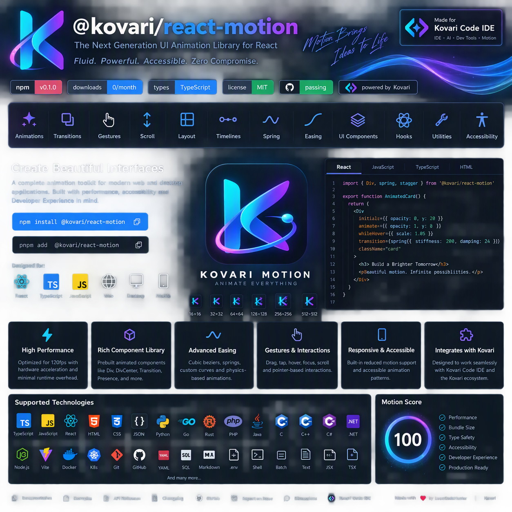

<div align="center">

<h1>@kovari/react-motion</h1>
<p><strong>ESM-first animation primitives for React, TypeScript, JavaScript and Kovari Code IDE.</strong></p>
<p><a href="https://www.npmjs.com/package/@kovari/react-motion"></a> <a href="https://github.com/LoonCodeHunter/react-motion/actions"></a>  <a target="_blank" rel="noopener noreferrer nofollow" href="https://score.motion.dev/site/motion.dev?utm_source=github&utm_medium=readme-badge"></a></p>

</div>

## Why motion?
Motion helps communicate hierarchy, causality and progress. Browser-native animation can offload suitable transforms and opacity work, while enhanced JavaScript APIs are useful for spring physics, timelines, interruption, gestures, scroll and layout transitions. For tiny self-contained hover effects, CSS remains a good choice.

## Why @kovari/react-motion?
Choose this package when building Kovari Code IDE or an ESM-first product that needs a compact, typed, independently maintained layer for easing, springs, timelines, values, gestures, scroll, layout and injected React components. The package keeps React optional and avoids bundling another React runtime.

## Motion and Motion+
[Motion](https://motion.dev/) is a separate MIT-licensed animation project. [Motion+](https://motion.dev/plus) is a separate paid professional toolkit with premium components, examples, tutorials, visual tools and AI resources. This package does not redistribute Motion+ source or premium APIs. Teams that own Motion+ may use its authorised assets alongside this package in their applications, subject to Motion+'s licence.

## Install
```bash
npm install @kovari/react-motion
```

## React
```tsx
import React from 'react';
import { createReactMotion, spring } from '@kovari/react-motion';
const { Div, DivCenter } = createReactMotion(React);
export function Card() {
  return <DivCenter initial={{ opacity: 0, y: 20 }} animate={{ opacity: 1, y: 0 }} whileHover={{ scale: 1.04 }} whileTap={{ scale: .98 }} transition={{ duration: spring({ stiffness: 200 }).duration }}>Kovari motion</DivCenter>;
}
```

## Modules
```text
dist/
├── es/
│   ├── index.js
│   ├── client.js
│   ├── dom.js
│   ├── easing.js
│   ├── gestures.js
│   ├── layout.js
│   ├── mini.js
│   ├── motion-value.js
│   ├── react.js
│   ├── scroll.js
│   ├── spring.js
│   └── timeline.js
└── types/
    └── matching declarations
```

## Development
```bash
npm install
npm run typecheck
npm test
npm run build
npm run check
npm run pack:dry
npm run publish:dry
```

Repository: [LoonCodeHunter/react-motion](https://github.com/LoonCodeHunter/react-motion)
