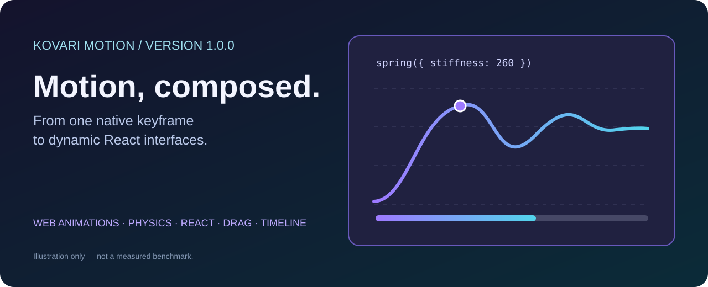
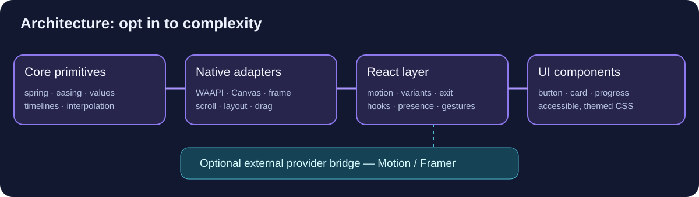

<div align="center">


# @kovari/react-motion

**Browser-native motion, expressive React animation, compact primitives.**

*ESM · TypeScript · WAAPI · React 18/19 target · Physics · Gestures · Scroll · Presence · Layout · Timelines*

[](./package.json)
[](https://www.npmjs.com/package/@kovari/react-motion)
[](https://github.com/LoonCodeHunter/react-motion/actions/workflows/ci.yml)
[](./docs/MOTION-SCORE.md)
[](./LICENSE)
[](./package.json)



[Getting started](#quick-start) · [API reference](./docs/API-REFERENCE.md) · [React guide](./docs/REACT-GUIDE.md) · [External adapters](./docs/ADAPTERS.md) · [UI recipes](./docs/UI-SYSTEM.md) · [Release checklist](./docs/PRODUCTION-READINESS.md) · [Badge policy](./docs/BADGES.md) · [GitHub](https://github.com/LoonCodeHunter/react-motion)
</div>

> [!IMPORTANT]
> **v1.0.0 source candidate, not yet certified or published as stable 1.0.0.** The uploaded project declares `1.0.0` for evaluation. At preparation time, GitHub `main` was still `0.1.2`, and official React 18/19/browser testing plus hosted CI remained required release gates. npm badges reflect the actual published package, not the unreleased source. See [production readiness](./docs/PRODUCTION-READINESS.md).

## Table of contents

- [Overview and philosophy](#overview-and-philosophy)
- [Full capabilities](#full-capabilities)
- [Architecture](#architecture)
- [Installation](#installation)
- [Quick start](#quick-start)
- [React components and variants](#react-components-and-variants)
- [Springs and motion values](#springs-and-motion-values)
- [Gestures, drag and momentum](#gestures-drag-and-momentum)
- [Presence and animated layout](#presence-and-animated-layout)
- [Scroll and viewport](#scroll-and-viewport)
- [Advanced timelines](#advanced-timelines)
- [Renderer and external adapters](#renderer-and-external-adapters)
- [Optional UI kit](#optional-ui-kit)
- [Modular imports](#modular-imports)
- [Performance, debugging and accessibility](#performance-debugging-and-accessibility)
- [Examples and guides](#examples-and-guides)
- [Build, test and release](#build-test-and-release)
- [Compatibility and limitations](#compatibility-and-limitations)
- [Contributing and licence](#contributing-and-licence)

## Overview and philosophy

Kovari React Motion provides a composable **native Web Animations core** with optional React bindings. A one-line DOM entrance should not require a full UI framework; a coordinated React application should still have modern animation components, hooks, gesture feedback and transition orchestration.

The library is structured around five principles: **browser-native playback**, **modular subpath imports**, **deterministic physics and animation values**, **declarative React where useful**, and **explicit interoperability** with independently installed animation engines. React is never imported by the primitive-only entry points.

It aims to be competitive with established React animation libraries through clear ownership, typed APIs and measurable performance. It **does not yet claim superiority to Motion/Framer Motion**: complete layout projection, complex gestures and extensive production browser evidence remain areas for improvement.

## Full capabilities

> **Badge accuracy:** `version` is pinned to `package.json` in this source tree; it never reads npm’s published `latest` or deprecated releases. The npm badge intentionally links to the package page without asserting its version. Run `npm run badges:check` before packaging.

| Category | Functions / components | Included behavior |
|---|---|---|
| **Native animation** | `animate`, `stagger`, `createKeyframes` | WAAPI-driven DOM keyframes, staggered starts, easing |
| **Springs** | `spring`, `springValue` | Physics curves, sample generation, smoothed signals |
| **Easing & interpolation** | `cubicBezier`, `steps`, `interpolate`, `mix`, `clamp` | Deterministic numbers and transitions |
| **React** | `motion.div`, `motion.button`, `MotionConfig` | Animated states for intrinsic HTML elements |
| **Variants** | `resolveVariant`, `staggerVariants`, `variants`, `custom` | Named, composed and function-based animation states |
| **Gestures** | `hover`, `press`, `pan`, `whileHover`, `whileTap`, `whileFocus` | Pointer/keyboard feedback, pointer-captured pan and swipe |
| **Dragging** | `drag`, `dragConstraints`, `dragMomentum` | Pointer capture, constraints, end velocity, inertia |
| **Layout** | `measure`, `layout`, `layoutId` | FLIP and basic shared layout snapshots |
| **Exit & presence** | `AnimatePresence`, `exit` | Direct keyed children; sync/wait modes |
| **Scroll** | `scroll`, `useScroll`, `inView`, `whileInView`, `bindScrollAnimation` | X/Y offsets, progress, viewport triggers and timeline scrubbing |
| **Motion values** | `motionValue`, `useMotionValue`, `useTransform`, `useSpring` | Subscriptions, derived signals and numeric mappings |
| **Timelines** | `timeline`, `createTimelineBuilder`, `staggerSequence` | Overlapping tracks, labels, seek/reverse/pause |
| **Animation controls** | `createAnimationControls`, `useAnimationControls` | Imperative control and state notifications |
| **Renderer adapters** | `frameAdapter`, `animateNumber`, `animateObject`, `animateCanvas` | Canvas/object/other renderers via callback loops |
| **Adaptive engines** | `createReactMotion(animate)`, `createMotionAdapter`, `createMotionAdapterRegistry`, `adaptMotionSource` | Typed React/imperative overloads, lazy driver loading and capability detection |
| **External engines** | `createReactMotionBridge`, `fromExternalMotionValue` | Explicit provider pass-through and one-way signals |
| **UI components** | `MotionButton`, `MotionCard`, `MotionReveal`, `MotionBadge`, `MotionProgress`, `MotionToggle`, `MotionSkeleton` | Semantic components and opt-in CSS |
| **Diagnostics** | `debug`, `createMotionInspector` | Opt-in events plus bounded, timed performance traces |
| **Accessibility** | `MotionConfig`, `useReducedMotion` | System reduced-motion option, focus and ARIA patterns |

## Architecture



The dependency boundaries are deliberate. `@kovari/react-motion/mini`, `/dom`, `/spring` and `/timeline` can be imported without React. `/react` and `/ui` load React and belong inside an application using the matching React/React DOM peer dependencies. `/provider-bridge` is dependency-light and does not automatically load Motion, Framer Motion or any other engine.

See [architecture guide](./docs/ARCHITECTURE.md) and [adapter contract](./docs/ADAPTERS.md) for ownership, cleanup and rendering boundaries.

## Next-generation utilities in v1.0.0

The new **opt-in modules** keep the root animation primitives small when you import targeted subpaths. They also avoid a global singleton or forced provider dependency.

### Pointer pan and swipe

```ts
import {pan} from '@kovari/react-motion/pan';

const stop = pan(tile, {
  axis: 'x', threshold: 5, swipeDistance: 60, swipeVelocity: 450,
  onMove: (_event, info) => {
    tile.style.transform = `translateX(${info.offset.x}px)`;
  },
  onSwipe: (_event, info) => console.log(info.direction),
});
// On view cleanup: stop();
```

`pan()` uses pointer capture, checks pointer identity, supports X/Y axis filtering and reports deltas, offsets, and velocity. It never silently changes `touch-action`, CSS positioning, or React state; specify `touch-action: pan-y` on horizontal draggables as appropriate. Pointer gestures should have accessible alternatives when used for essential actions.

### Scroll-linked Web Animations scrubbing

```ts
import {scroll} from '@kovari/react-motion/scroll';
import {bindScrollAnimation} from '@kovari/react-motion/scroll-scrub';

const tracker = scroll(document.querySelector('.scroll-pane')!);
const waapi = document.querySelector('.hero')!.animate(
  [{opacity: 0, transform: 'translateY(24px)'}, {opacity: 1, transform: 'translateY(0)'}],
  {duration: 1000, fill: 'both'},
);
const scrub = bindScrollAnimation(tracker.progress, waapi, {duration: 1000, range: [0.1, 0.85]});
// On cleanup: scrub.stop(); tracker.stop(); waapi.cancel();
```

The scrubber controls `currentTime` without rerendering React and **does not** take ownership of the source tracker or browser animation. It has explicit range and duration validation and deterministic cleanup.

### Lazy animation-engine registration

```ts
import {createMotionAdapterRegistry} from '@kovari/react-motion/adapter-registry';
import {createAnimateAdapter} from '@kovari/react-motion/adapter-factory';

const registry = createMotionAdapterRegistry();
registry.register('motion', async () => {
  const {animate} = await import('motion'); // optional peer installed by your application
  return createAnimateAdapter(animate);
});
const provider = await registry.resolve('motion');
provider.animate('.tile', {opacity: [0, 1]}, {duration: 0.35});
```

Resolution is deduplicated across concurrent requests and a failed load can be retried; registration changes invalidate stale in-flight providers. No Motion code loads into an application that does not resolve this registration. The registry does **not** dispose animations it didn't create—owners remain responsible for cancellation.

### Opt-in performance inspector

```ts
import {createMotionInspector} from '@kovari/react-motion/inspector';
const inspector = createMotionInspector({enabled: true, maxRecords: 500, frameBudgetMs: 16.67});
const finish = inspector.start('card entrance', 'transition');
// ... animate and await its completion ...
finish();
console.log(inspector.summary('transition'));
```

The inspector stores bounded, local timing records and exposes mean, 95th percentile and threshold crossings. This measures your recorded spans, **not** actual compositor frame time or independent proof of better performance than Motion.

React users can also import the typed `usePan`, `useScrollScrub` and `useMotionInspector` hooks from `@kovari/react-motion/react`; these handle effect teardown and keep the underlying modules framework-independent.

See [extended API reference](./docs/NEXT-GENERATION.md) and [feature readiness](./docs/FEATURE-PARITY.md).

## v1.0.0 renderer API families and engineering upgrade

**New in this revised v1.0.0 source** — browser/Web Animations scopes, SVG drawing, numeric Canvas tweens, Electron/Tauri visibility-aware renderers, bounded debug sessions and developer frame diagnostics. The underlying v1 candidate already had `motion.*`, springs, gestures, drag, variants, presence, layout, timeline builder, external adapters and a React UI gallery.

| Entry point | Primary surface | Purpose |
|---|---|---|
| `@kovari/react-motion/react` | React | Components, presence, variants, hooks and gesture states |
| `@kovari/react-motion/web` | Browser DOM | Scoped selectors, native WAAPI handles, stagger, dispose |
| `@kovari/react-motion/svg` | SVG | Native `animateSVG()` plus stroke `drawPath()` |
| `@kovari/react-motion/canvas` | Canvas/WebGL/custom | Typed numeric `tweenCanvas()` with seek/pause/reverse |
| `@kovari/react-motion/desktop` | Electron/Tauri renderer | Visibility-aware animation scopes |
| `@kovari/react-motion/devtools` | Development | rAF frame sampler and opt-in status HUD |
| `@kovari/react-motion/debug` | Development | Bounded debug log, subscriptions and lifecycle traces |

```tsx
'use client';
import { motion, AnimatePresence } from '@kovari/react-motion/react';

const variants = {
  hidden: {opacity: 0, y: 18},
  visible: {opacity: 1, y: 0, transition: {type: 'spring' as const, stiffness: 260}},
};

export function Intro({show}: {show:boolean}) {
  return <AnimatePresence>
    {show && <motion.div key="intro" initial="hidden" animate="visible" exit="hidden"
      variants={variants} whileHover={{scale:1.02}}>
      Motion, composed.
    </motion.div>}
  </AnimatePresence>;
}
```

**Interactive runnable demo:** [Renderer Laboratory](./examples/renderer-lab/README.md) for browser/Electron/Tauri WebViews, plus the existing [React Showcase](./examples/react-showcase/README.md).

**Engine documentation:** [Complete API surfaces](./docs/API-SURFACES-v1.md) · [Feature research and comparison](./docs/COMPETITOR-RESEARCH-v1.md) · [Desktop integration](./docs/DESKTOP-AND-RENDERERS.md) · [Debugging](./docs/DEBUGGING-v1.md) · [Release engineering report](./docs/RELEASE-V1-ENGINEERING.md).

> **Version note:** the v1.0.0 badge identifies this source archive's manifest, **not** npm's published latest tag. This package has to pass the final consumer/hosted CI checks before it can be called publicly released. There are no independently verified claims of faster FPS or smaller bundles than competitors here.

## Installation

```bash
npm view @kovari/react-motion version
```

The command above shows the version available on the public registry. After a verified stable v1 release, installation is:

```bash
npm install @kovari/react-motion
npm install react react-dom  # React applications only
```

**To test this unreleased v1 source**: unzip it, run `npm ci`, `npm run release:check`, `npm pack --ignore-scripts`, then install the generated `.tgz` into a separate app. Do not assume that a source version is already published on npm.

## Quick start

### Browser-native animation with minimal dependencies

```js
import { animate, stagger } from '@kovari/react-motion/dom';

const nodes = [...document.querySelectorAll('.tile')];
const delayFor = stagger(55, 25);
const running = nodes.map((node, i) => animate(node, [
  { opacity: 0, transform: 'translateY(18px) scale(.98)' },
  { opacity: 1, transform: 'translateY(0) scale(1)' },
], { duration: 360, delay: delayFor(i), easing: 'cubic-bezier(.2,.8,.2,1)', fill: 'both' }));

// Dispose with the view: running.forEach(a => a.cancel());
```

`animate()` uses a browser `Animation` handle. Keyframe options use milliseconds. For simple, constant hover effects, native CSS transitions may be more appropriate.

### React animation in a client component

```tsx
'use client';
import { motion, AnimatePresence } from '@kovari/react-motion/react';

const variants = {
  hidden: { opacity: 0, y: 24, scale: .98 },
  visible: { opacity: 1, y: 0, scale: 1, transition: { duration: 290 } },
};

export function Welcome({ show }: { show: boolean }) {
  return <AnimatePresence mode="wait">
    {show && <motion.article
      key="welcome"
      initial="hidden" animate="visible" exit="hidden" variants={variants}
      whileHover={{ y: -4, scale: 1.02 }} whileTap={{ scale: .98 }}
    ><h2>Motion you can compose.</h2></motion.article>}
  </AnimatePresence>;
}
```

React controls should have proper semantics: use `motion.button` for actionable elements. The `AnimatePresence` implementation targets direct, keyed Kovari motion children, not arbitrary nested animations.

## React components and variants

`motion.div`, `motion.button`, `motion.section`, `motion.article` and other intrinsic HTML elements share the adapter. The React layer supports `initial`, `animate`, `exit`, `whileHover`, `whileTap`, `whileFocus`, `whileDrag`, `whileInView`, `transition`, `variants`, `custom`, `layout`, `layoutId`, and drag props.

Dynamic variant functions can receive `custom` data, allowing calculated stagger and layout-dependent state. For programmatic state, call `useAnimationControls()` and pass its instance to `animate`. `MotionConfig reducedMotion="user"` respects the system motion preference unless configured otherwise. See [React guide](./docs/REACT-GUIDE.md) for state precedence and limitations.

```tsx
import { motion, useAnimationControls } from '@kovari/react-motion/react';
function RevealButton() {
  const controls = useAnimationControls();
  return <><button onClick={() => controls.start({ opacity: 1, x: 0 })}>Show</button>
    <motion.div initial={{ opacity: 0, x: -20 }} animate={controls}>Content</motion.div></>;
}
```

## Springs and motion values

```js
import { spring, motionValue } from '@kovari/react-motion/mini';

const curve = spring({ mass: 1, stiffness: 260, damping: 22 });
console.log(curve.at(120), curve.duration, curve.sample(48));

const progress = motionValue(0);
const off = progress.subscribe(() => console.log(progress.get(), progress.velocity()));
progress.set(.45);
off();
progress.destroy();
```

`spring()` samples a physics curve; for DOM playback, transform samples into keyframes or use the React spring transition. Motion values notify subscribers directly without requiring every frame to rerender React. React helpers `useMotionValue`, `useTransform`, `useSpring`, `useMotionValueEvent`, and `useScroll` compose values with automatic effect cleanup where implemented.

## Gestures, drag and momentum

```tsx
import { motion } from '@kovari/react-motion/react';
export function Draggable() {
  return <motion.div
    drag="x" dragMomentum dragConstraints={{ left: -130, right: 130 }}
    whileDrag={{ scale: 1.035 }}
    onDragEnd={(_e, info) => console.log(info.offset.x, info.velocity.x)}
    style={{ touchAction: 'none', padding: 28, cursor: 'grab' }}
  >Drag me horizontally</motion.div>;
}
```

The low-level `drag(element, options)` reports position, deltas and release velocity. Inertia decays and returns inside constraints. Drag is not an accessible replacement for buttons, menus or keyboard alternatives for essential tasks. Nested drag/touch/scroll behaviors need real-browser verification.

## Presence and animated layout

`AnimatePresence` handles basic direct-child exit transitions in `sync` and `wait` modes. Use stable keys and an `exit` visual state. The `layout` flag measures before/after DOM geometry and applies a FLIP-style transform; `layoutId` shares snapshots within the adapter instance. Complex projection across portals, deeply nested scroll containers or simultaneous competing transforms is not claimed as fully supported.

## Scroll and viewport

```js
import { scroll } from '@kovari/react-motion/scroll';
const container = document.querySelector('.scroller');
if (container) {
  const tracker = scroll(container);
  const update = () => console.log(tracker.progress.get());
  const stop = tracker.progress.subscribe(update);
  update();
  // Dispose: stop(); tracker.stop();
}
```

`scroll()` reports vertical/horizontal offsets and progress. `inView()` and `whileInView` use IntersectionObserver where available. For actual smooth scrolling use the browser's own `scrollTo({behavior:'smooth'})`, with reduced-motion fallbacks. See [React guide](./docs/REACT-GUIDE.md).

## Advanced timelines

```js
import { createTimelineBuilder } from '@kovari/react-motion/timeline-builder';

const sequence = createTimelineBuilder()
  .label('intro', 0)
  .add(title, [{opacity:0},{opacity:1}], {duration:260,fill:'both'}, 'intro')
  .stagger(cards, [{opacity:0},{opacity:1}], 55, {duration:300,fill:'both'}, 'intro+=120')
  .build();
sequence.play();
// sequence.pause(); sequence.seek(180); sequence.reverse(); sequence.cancel();
```

The timeline engine supports labels, relative offsets, overlaps, scrubbing and cancellation. The builder allows auditing planned segments with `.inspect()` before `.build()`. Timing units are **milliseconds**. See [timeline reference](./docs/TIMELINES.md).

## Renderer and external adapters

### Built-in Canvas/object animation drivers

```ts
import { animateObject, frameAdapter, animateCanvas } from '@kovari/react-motion/adapters';
const entity = { rotation: 0 };
const rotation = animateObject(entity, 'rotation', 180, { duration: 600 });
const driver = frameAdapter({ duration: 400, onUpdate: progress => console.log(progress) });
driver.play();
// Stop when no longer needed: rotation.cancel(); driver.cancel();
```

The frame driver is renderer-agnostic; Canvas, WebGL and game rendering systems own their drawing callbacks, rather than assuming Kovari manages their scenes.

### Motion / Framer Motion integration (separately installed)

```tsx
'use client';
import { motion as externalMotion, AnimatePresence as ExternalPresence } from 'motion/react';
import { createReactMotionBridge } from '@kovari/react-motion/provider-bridge';

const engine = createReactMotionBridge({
  name: 'motion/react', motion: externalMotion, AnimatePresence: ExternalPresence,
});
const M = engine.motion;
export function ExternalAnimatedCard() {
  return <M.div whileHover={{ scale: 1.03 }}>This component uses the external Motion engine.</M.div>;
}
```

To use the `framer-motion` npm package instead, import `motion` and `AnimatePresence` from `'framer-motion'` and pass them to the same bridge. **Neither external package is bundled.** You can import the external signal with `fromExternalMotionValue(externalValue)`, which returns `{ value, stop }`, or mirror a Kovari value to an external writable one via `syncToExternalMotionValue(local, external)` (returning an unsubscribe function). These signal bridges are intentionally **one-way** to avoid cycles. Provider ownership stays with its original engine.

**Important distinction:** `createReactMotion(React)` from `/react-adapter` expects a React-compatible hooks runtime, **not** the `motion` component factory from another library. Use `createReactMotionBridge({motion})` for external engines. Complete examples and adapter caveats are in [ADAPTERS.md](./docs/ADAPTERS.md).

## Universal adapters: React, Motion and custom engines

**All integration entry points are explicit.** There is no automatic dependency on `motion`, `framer-motion`, React or Three.js when importing `/adapter-factory`. Import only the provider your application actually needs.

### Option A — React runtime: components, hooks and local Web Animations

```tsx
import * as React from 'react';
import { createReactMotion } from '@kovari/react-motion/react-adapter';

const { motion, AnimatePresence, useMotionValue, engine } = createReactMotion(React);
// engine.capabilities.react === true
export function Example() {
  return <motion.div initial={{opacity:0, y:18}} animate={{opacity:1,y:0}} whileHover={{scale:1.02}}>Hello</motion.div>;
}
```

### Option B — Motion's animate function: imperative animation without React

```ts
import { animate } from 'motion';
import { createReactMotion } from '@kovari/react-motion/react-adapter';

const engine = createReactMotion(animate);
// engine.kind === 'animate'; engine.capabilities.react === false
const playback = engine.animate('.cards', {opacity:[0,1], y:[14,0]}, {duration:.4});
// playback's lifecycle and supported options come from Motion.
```

An `animate` function does **not** contain React hooks or JSX component constructors. This overload returns an imperative adapter, not `motion.div`; that distinction prevents misleading runtime behavior.

### Option C — Composition: React + Motion component provider + custom driver

```tsx
import * as React from 'react';
import { animate } from 'motion';
import { motion, AnimatePresence, MotionConfig } from 'motion/react';
import { createMotionAdapter } from '@kovari/react-motion/adapter-factory';

const adapter = createMotionAdapter({
  name: 'my-ui-engine', react: React, animate, motion, AnimatePresence, MotionConfig,
  onError: (error) => console.error('Animation provider failed', error),
  reducedMotion: 'user',
});

adapter.isSupported('presence'); // true: supplied by the external provider
const NativeMotionDiv = adapter.motion?.div; // provider-owned component
```

If you want Kovari's own React components **and** an imperative engine bound together, call `createReactMotion(React, {animate})` from `/react-adapter` and use its `.engine.animate(...)` method. For `framer-motion`, inject its `animate`, `motion`, and `AnimatePresence` exports into the same adapter factory. No premium libraries are bundled or copied.

### What adapters do and do not do

- **Do:** dispatch animation calls, report provider capabilities, preserve external components, expose composable Kovari motion values, offer cleanup-aware one-way signal bridges and error callbacks.
- **Do not:** translate every provider-specific spring option, share a layout projection tree across engines, guarantee every gesture implementation is equivalent, or fabricate React components out of an imperative animate function.
- **Performance:** adapter metadata reports supplied capabilities, not benchmark scores. Verify bundle size, frame timing, gesture correctness, React 18/19 compatibility and reduced-motion behavior in production CI.

Full typed configuration, cleanup examples and compatibility guidance: [Advanced adapters](./docs/ADAPTERS.md).

## Optional UI kit

```tsx
'use client';
import { MotionButton, MotionCard, MotionProgress, MotionToggle } from '@kovari/react-motion/ui';
import '@kovari/react-motion/ui.css';
export function StatusCard({ progress }: { progress: number }) {
  return <MotionCard>
    <h2>Building project</h2>
    <MotionProgress value={progress} label="Build progress" />
    <MotionButton type="button" onClick={() => console.log('Open logs')}>Open logs</MotionButton>
    <MotionToggle pressed={false} onPressedChange={value => console.log(value)} aria-label="Animation preference" />
  </MotionCard>;
}
```

This illustrates a controlled `MotionToggle`; in a real app store `pressed` state in React. Seven opt-in semantic UI components use `/ui.css` design tokens. A decorative `MotionSkeleton` needs a readable status next to it. See [UI system guide](./docs/UI-SYSTEM.md).

## Modular imports

| Import path | Category | React dependency |
|---|---|---|
| `@kovari/react-motion` | Core primitives and renderer integrations | None |
| `/mini`, `/dom`, `/spring`, `/spring-value`, `/easing` | Compact native motion | None |
| `/motion-value`, `/motion-combine`, `/transform`, `/interpolate` | Reactive numeric values | None |
| `/timeline`, `/timeline-builder`, `/sequence` | Timeline composition | None |
| `/gestures`, `/drag`, `/inertia` | Input and physics | None |
| `/scroll`, `/observe`, `/layout`, `/shared-layout`, `/presence` | Position and lifecycle utilities | None |
| `/adapters`, `/provider-bridge` | Custom targets and external providers | None; provider optional |
| `/react`, `/react-client` | Components and hooks | React required |
| `/react-adapter` | Injected React factory | React supplied by host |
| `/ui`, `/ui.css` | Semantic animated UI + styles | React required for `/ui` |
| `/presets`, `/variants`, `/controls`, `/keyframes`, `/debug` | Focused core helpers | None |

The declared `package.json` exports are canonical. Every compiled entry must be checked with the included package verifier.

## Performance, debugging and accessibility

**Native vs JavaScript:** WAAPI performs DOM playback; motion values and Canvas drivers run JS updates. Neither ensures perfect frame rates. Prefer transform/opacity for high-frequency animation where practical, minimize repeated layout reads, and cancel subscriptions/animations when their view disappears.

```js
import { debug } from '@kovari/react-motion/debug';
debug.enable();
debug.log('ui', 'animation started', { surface: 'card' });
console.table(debug.records());
debug.clear();
debug.disable();
```

**Accessibility:** Respect `prefers-reduced-motion`; keep real button and focus semantics; offer non-drag alternatives; ensure every loading and progress component has useful accessible text. Avoid large vestibular transitions, flashing and focus jumps during exit animation.

**Motion Score:** Kovari's 0–100 benchmark measures frame cadence (40%), spring throughput (20%), motion-value throughput (20%) and animation timing (20%). Bands: red 0–49, yellow 50–69, green 70–89, yellow-green 90–100. It is a specific browser-runner signal, **not** a universal performance ranking or proof of being faster than Motion. See [MOTION-SCORE.md](./docs/MOTION-SCORE.md), [PERFORMANCE.md](./docs/PERFORMANCE.md) and [ACCESSIBILITY.md](./docs/ACCESSIBILITY.md).

## Examples and guides

| Document | What's covered |
|---|---|
| [API reference](./docs/API-REFERENCE.md) | Public imports, signatures and semantics |
| [React guide](./docs/REACT-GUIDE.md) | Component states, drag, variants, presence, SSR, lifecycle |
| [Adapters](./docs/ADAPTERS.md) | Native frame/Canvas drivers and provider bridges |
| [Timelines](./docs/TIMELINES.md) | Labels, overlap, seek, cancellation |
| [UI system](./docs/UI-SYSTEM.md) | Semantic components, design tokens, accessibility |
| [Recipes](./docs/RECIPES.md) | Cards, menus, scroll and loading examples |
| [Architecture](./docs/ARCHITECTURE.md) | Dependency boundaries |
| [Accessibility](./docs/ACCESSIBILITY.md) | Reduced motion, focus and keyboard alternatives |
| [Performance](./docs/PERFORMANCE.md) | Profiling and fair competitor comparisons |
| [Troubleshooting](./docs/TROUBLESHOOTING.md) | Windows, npm, SSR and CI errors |
| [Windows npm pack export-test fix](./docs/WINDOWS-PATH-FIX.md) | Fix duplicated `C:\C:\` paths in `tests/exports.test.mjs`; includes Windows commands and regression coverage |
| [Feature parity](./docs/FEATURE-PARITY.md) | Remaining gaps relative to Motion |
| [Migration](./docs/MIGRATION-v1.md) | Upgrading from 0.1.x |
| [Production checklist](./docs/PRODUCTION-READINESS.md) | Release gates and acceptance evidence |

## Build, test and release

```bash
npm ci
npm run typecheck
npm test
npm run docs:check
npm run pack:verify
npm run release:check
npm pack --ignore-scripts
```

**Windows packaging note:** If `npm pack` reports `C:\C:\Users\...` in `tests/exports.test.mjs`, use the [Windows export-test fix](./docs/WINDOWS-PATH-FIX.md). Both failed export tests are fixed in the included source by using `file:` URLs instead of converting `.pathname` through `path.resolve`.

These commands require the complete source tree. `npm pack` produces a local tarball; verify it in a fresh consumer application before publishing. GitHub Actions has a Node version matrix and a React 18/19 consumer workflow. **Only actual hosted runs demonstrate hosted compatibility.** The current source candidate includes an implementation for `verify:lockfile`, which the older GitHub tree's Motion Score workflow was missing. Consult [production readiness](./docs/PRODUCTION-READINESS.md) before publishing.

## Compatibility and limitations

- Node `>=20.19` is declared for tooling; browser animation helpers require browser APIs.
- React 18 and 19 are peer targets. Real React DOM/SSR/browser tests must pass before advertising full support.
- The React layer is not a full clone of Motion: nested presence, shared-element projection, complex gesture recognition, SVG motion and feature-complete layout correction remain areas for work.
- External integration is **pass-through**, not automatic conversion of external variants, springs or internal motion values.
- TypeScript compilation, unit tests and package verification do not establish accessibility certification or comparative performance superiority.
- No published `1.0.0` availability is assumed. Check the npm registry first.

## Contributing and licence

Open reproducible reports via [GitHub Issues](https://github.com/LoonCodeHunter/react-motion/issues). Contributions should include focused tests, documentation for API changes and reduced-motion/cleanup review. Run registry-backed `npm audit --audit-level=high` when available; if offline, don't claim a clean audit. Retain the MIT licence notices from [LICENSE](./LICENSE). Motion and Motion+ are independent products; provider examples do not bundle or endorse their code.

---
<div align="center"><strong>Expressive motion. Measurable engineering. Modular by design.</strong></div>
