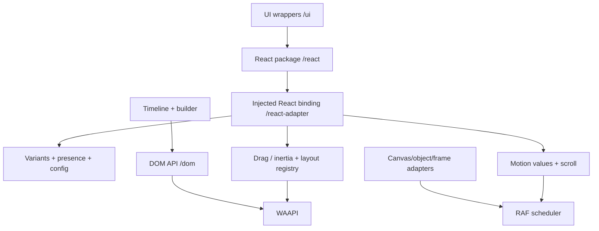

# Architecture — v1 RC

Each primitive lives in `src/<feature>.ts` and is independently exported under a corresponding package subpath. Core modules do not import React. React and UI peers are only loaded from `/react` and `/ui`. The emitted `dist/es` tree and `dist/types` tree are generated by TypeScript; no network code generation is used.

**Lifecycle ownership:** React effects own observer/gesture handles; listeners and frame callbacks must be cleaned up on unmount. `AnimationControls` can be instantiated outside React and subscribed to by a mounted component. Shared-layout registries store measured rectangles, not DOM nodes. The Motion Score system lives only in this package.

**Current limitations:** visual transform channels aren't yet merged via a full projection engine; direct composition of a draggable X style signal plus an explicit drag offset must be intentional. Basic shared geometry is not equivalent to Motion's rich layout projection. Real React browser tests remain a release gate.
